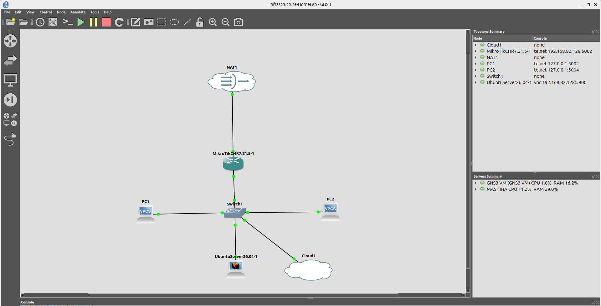
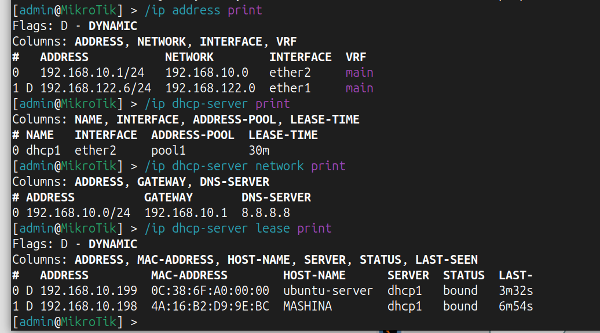
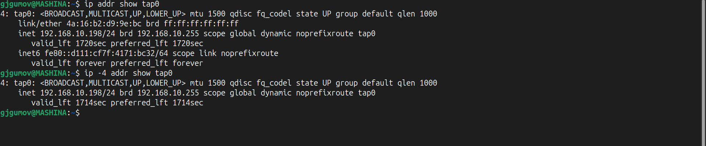
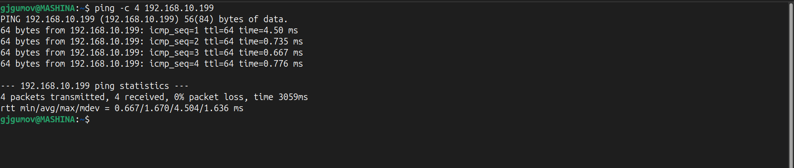

# Lab 01.5 – Building a Management Network

## Overview

The purpose of this lab is to build a dedicated management network that allows the Ubuntu Desktop host to securely access and manage devices running inside the GNS3 topology.

This management network serves as the foundation for all future networking, Linux, Docker, Kubernetes, automation, and DevOps labs.

---

# Technologies Used

- Ubuntu Desktop
- Ubuntu Server
- MikroTik CHR
- GNS3
- Ethernet Switch
- Cloud Node
- TAP Interface
- DHCP
- SSH
- Git
- GitHub

---

# Objectives

- Connect Ubuntu Desktop to the GNS3 topology
- Build a dedicated management network
- Configure DHCP services
- Obtain an IP address automatically
- Verify Layer 3 connectivity
- Verify SSH connectivity
- Prepare the infrastructure for future enterprise labs

---

# Network Topology

```text
                 Internet
                     │
                   NAT
                     │
             MikroTik ether1
                     │
             MikroTik ether2
                     │
             Ethernet Switch
      ┌──────────────┼──────────────┐
      │              │              │
 Ubuntu Server      VPCS       Cloud (tap0)
                                    │
                             Ubuntu Desktop
```

## Physical Topology



---

# MikroTik Configuration

The MikroTik CHR router acts as the default gateway and DHCP server for the management network.



---

# Client IP Address

The Ubuntu Desktop successfully obtained an IP address from the MikroTik DHCP server.



---

# Connectivity Test

ICMP connectivity between the Ubuntu Desktop and Ubuntu Server was successfully verified.



---

# Verification

```bash
ping 192.168.10.199

ssh gjgumov@192.168.10.199
```

Expected Result:

- Successful ICMP connectivity
- Successful SSH login
- Ubuntu Desktop can securely manage devices inside the GNS3 topology

## SSH Verification


---

# Network Overview

| Device | IP Address | Purpose |
|---------|------------|----------|
| MikroTik CHR | 192.168.10.1 | Default Gateway / DHCP Server |
| Ubuntu Desktop | 192.168.10.198 | Management Client |
| Ubuntu Server | 192.168.10.199 | SSH Server |

---

# Lessons Learned

- Built a dedicated management network using MikroTik RouterOS.
- Configured DHCP services for automatic IP address assignment.
- Integrated the Ubuntu Desktop into the GNS3 topology using a TAP interface.
- Verified Layer 3 connectivity using ICMP.
- Successfully established SSH connectivity between the Ubuntu Desktop and Ubuntu Server.
- Learned how GNS3 Cloud nodes and TAP interfaces integrate a physical Linux host into a virtual network.
- Troubleshot a routing issue caused by the TAP interface becoming the default gateway and resolved it by configuring the TAP connection to never become the default route.

---

# Technologies Practiced

- Linux Networking
- MikroTik RouterOS
- DHCP
- IPv4 Addressing
- Layer 2 Switching
- Layer 3 Routing
- ICMP
- SSH
- GNS3
- TAP Interface
- Git
- GitHub

---

# Next Lab

➡️ **Lab 02 – VLAN Fundamentals**