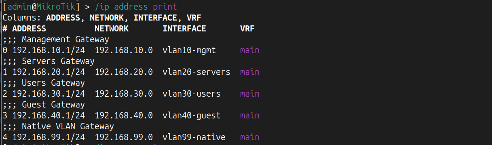
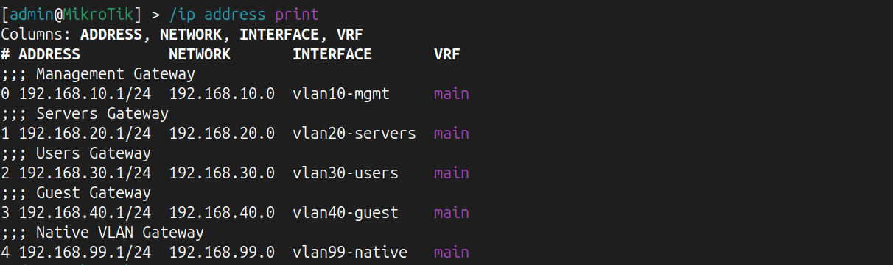
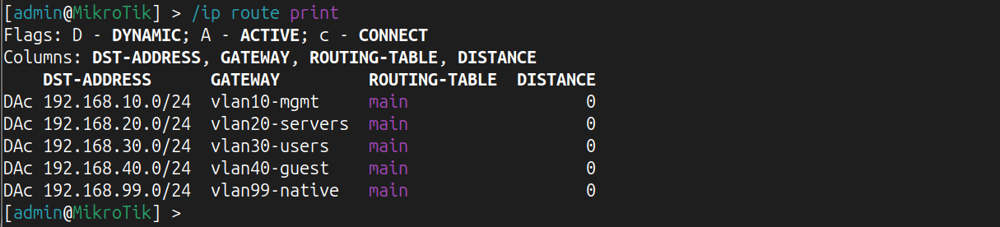
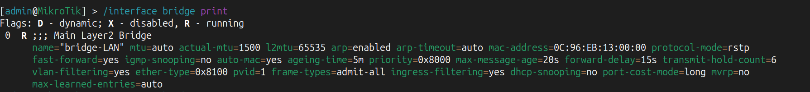
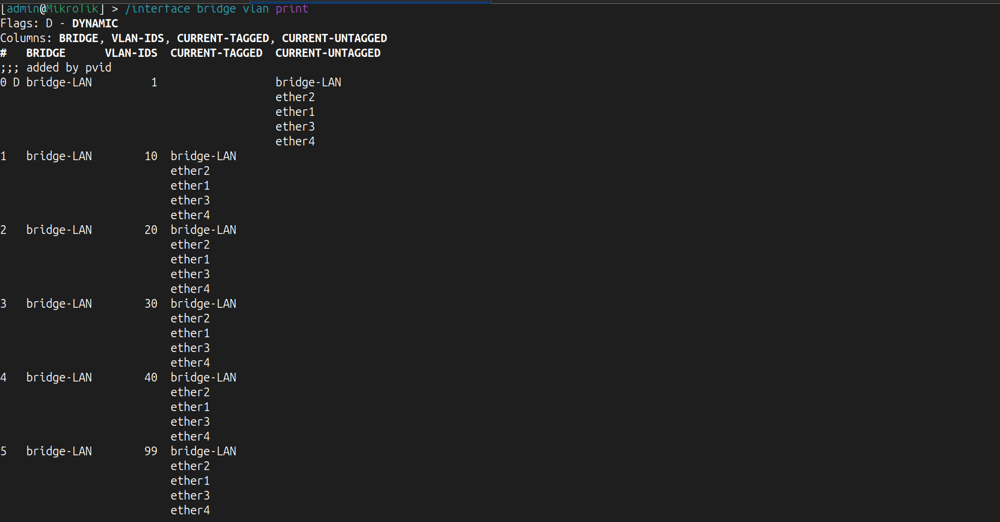
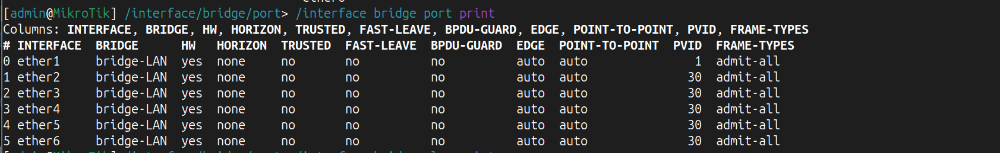
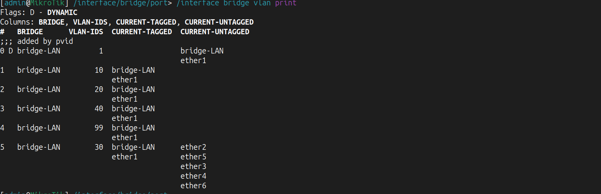
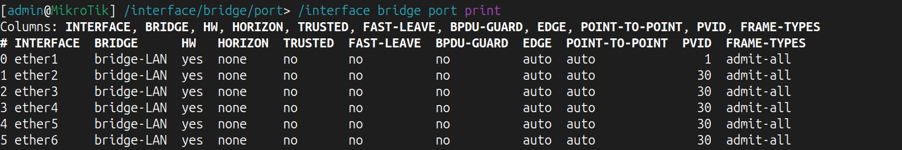
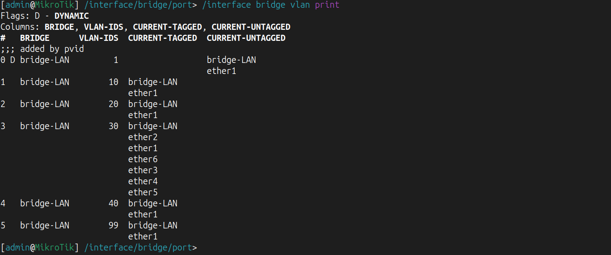

# Lab 02 - Enterprise VLAN Switching

## Overview

This lab focuses on implementing the Layer 2 infrastructure of the Enterprise HomeLab.

The objective is to build a scalable switching environment using MikroTik RouterOS by implementing VLAN segmentation, trunk links, access ports, bridge configuration, and VLAN filtering.

This lab provides the Layer 2 foundation required for future services such as DHCP, Inter-VLAN Routing, NAT, OSPF, and Infrastructure Automation.

---

## Skills Covered

- VLAN
- IEEE 802.1Q
- Bridge
- VLAN Filtering
- Trunk Ports
- Access Ports
- Tagged Traffic
- Untagged Traffic
- PVID
- Enterprise Layer 2 Switching

# Objectives

- Configure enterprise Layer 2 switching
- Implement VLAN segmentation
- Configure trunk and access ports
- Enable VLAN filtering
- Configure PVID on access ports
- Prepare the network for Layer 3 routing

---

# Network Topology


---

# Theory

## What is a VLAN?

A VLAN (Virtual Local Area Network) is a logical separation of devices inside the same physical network. VLANs isolate broadcast domains and improve security, scalability, and network management.

---

## Broadcast Domains

Each VLAN represents its own broadcast domain.

- VLAN10 – Management
- VLAN20 – Servers
- VLAN30 – Users
- VLAN40 – Guest
- VLAN99 – Native

---

## Bridge

A Bridge in MikroTik acts as a Layer 2 switch by forwarding Ethernet frames based on MAC addresses.

---

## VLAN Filtering

VLAN Filtering enables VLAN awareness on the bridge. Without it, VLAN configuration will not be enforced.

---

## Tagged vs Untagged

### Tagged

Used between:

- Switch ↔ Switch
- Switch ↔ Router

### Untagged

Used by end devices:

- PCs
- Servers
- Printers

---

## Trunk Port

A trunk port carries multiple VLANs over a single physical interface.

---

## Access Port

An access port belongs to only one VLAN and sends/receives untagged traffic.

---

## PVID

PVID (Port VLAN ID) assigns incoming untagged frames to a specific VLAN.

Example:

```
ether2
PVID = 30
```

Every untagged frame arriving on ether2 becomes part of VLAN30.

---

# VLAN Plan

| VLAN | Name | Network | Gateway |
|------|------------|----------------|----------------|
|10|Management|192.168.10.0/24|192.168.10.1|
|20|Servers|192.168.20.0/24|192.168.20.1|
|30|Users|192.168.30.0/24|192.168.30.1|
|40|Guest|192.168.40.0/24|192.168.40.1|
|99|Native|192.168.99.0/24|192.168.99.1|

---

# Configuration Summary

## R2-CORE

Configured:

- VLAN Interfaces
- Default Gateways
- Connected Routes

### VLAN Interfaces



### IP Addresses



### Routing Table



---

## SW1-CORE

Configured:

- Bridge
- VLAN Filtering
- VLAN Table
- Trunk Ports

### Bridge



### VLAN Table



---

## SW2-ACCESS

Configured:

- Bridge
- Access Ports
- Trunk Port
- VLAN30 Untagged
- PVID 30

### Access Ports



### VLAN Table



---

## SW3-ACCESS

Configuration identical to SW2.

### Access Ports



### VLAN Table



---

## Packet Flow

Example:

PC01 (VLAN30)

↓

SW2-ACCESS

↓

SW1-CORE

↓

R2-CORE (Gateway)

↓

Destination Network

# Verification

The following items were successfully verified:

- ✅ Bridge created
- ✅ VLAN Filtering enabled
- ✅ VLAN Table configured
- ✅ Tagged trunk ports configured
- ✅ Untagged access ports configured
- ✅ PVID configured correctly

---

# Troubleshooting

## Issue 1

Access ports were initially configured as tagged.

**Resolution:**

Changed access ports to untagged.

---

## Issue 2

PVID remained VLAN1.

**Resolution:**

Configured PVID = 30 on all access ports.

---

## Issue 3

Duplicate IP address configured on the physical interface and VLAN interface.

**Resolution:**

Removed the IP address from the physical interface and kept it only on the VLAN interface.

---

# Lessons Learned

During this lab the following concepts became clear:

- Difference between Layer 2 and Layer 3
- Difference between Trunk and Access ports
- Difference between Tagged and Untagged traffic
- Purpose of Bridge VLAN Filtering
- Importance of PVID
- Enterprise VLAN design principles

---

# Interview Questions

- What is a VLAN?
- What is a Broadcast Domain?
- What is a Trunk Port?
- What is an Access Port?
- What is PVID?
- What is VLAN Filtering?
- Why do end devices send untagged traffic?
- Explain the packet flow from a PC to the default gateway.

---

# Next Lab

## Lab 03 - DHCP Services

The next lab will cover:

- DHCP Pools
- DHCP Networks
- DHCP Server
- DNS Configuration
- Automatic IP Address Assignment
- Client Connectivity Testing

---

**Status:** ✅ Completed