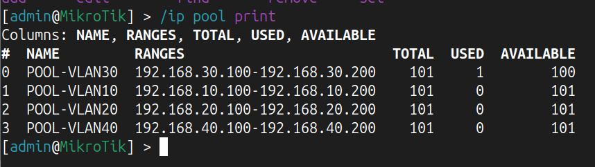
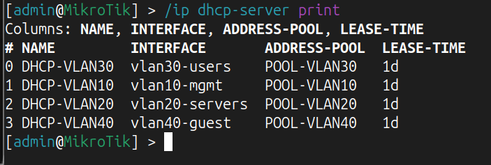
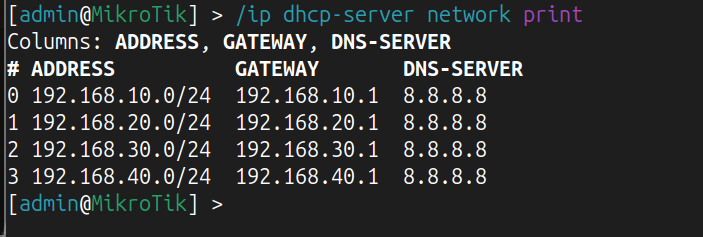
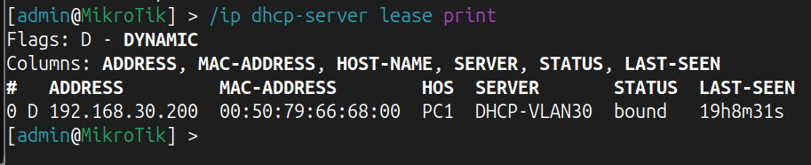
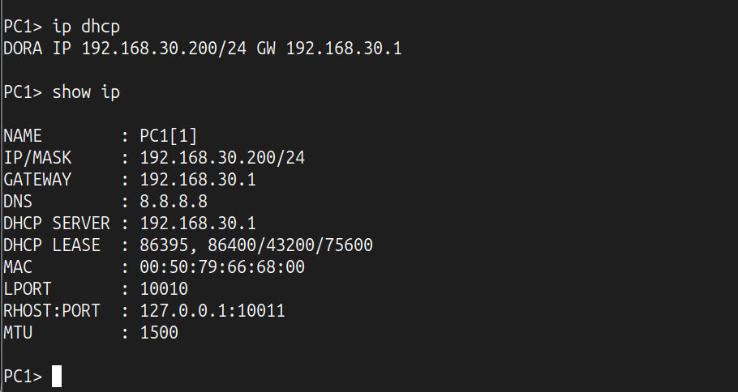
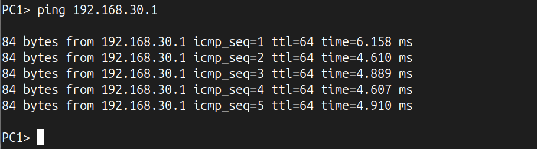

# Lab 03 - DHCP Services

## Overview

This lab focuses on implementing Dynamic Host Configuration Protocol (DHCP) services for the Enterprise HomeLab.

The objective is to provide automatic IP address assignment for all client VLANs using MikroTik RouterOS.

DHCP simplifies network administration by automatically assigning IP configuration to client devices.

---

# Objectives

- Configure DHCP Pools
- Configure DHCP Servers
- Configure DHCP Networks
- Assign automatic IP addresses
- Verify DHCP leases
- Test client connectivity
- Prepare the network for future Internet connectivity

---

# Theory

## What is DHCP?

DHCP (Dynamic Host Configuration Protocol) is a network protocol that automatically assigns IP configuration to client devices.

Instead of manually configuring every device, a DHCP Server provides:

- IP Address
- Subnet Mask
- Default Gateway
- DNS Server
- Lease Time

---

## DHCP DORA Process

DHCP communication consists of four steps:

1. Discover
2. Offer
3. Request
4. Acknowledge (ACK)

The client first broadcasts a DHCP Discover message because it does not yet have an IP address or know the DHCP Server's address.

---

## DHCP Pool

A DHCP Pool defines the range of IP addresses that the DHCP Server can assign.

Example:

```
192.168.30.100 - 192.168.30.200
```

---

## DHCP Server

Each VLAN has its own DHCP Server that listens on its corresponding VLAN interface.

---

## DHCP Network

A DHCP Network provides additional configuration information such as:

- Default Gateway
- DNS Server
- Network Address

The DHCP Network does not assign IP addresses; it provides network parameters to the client.

---

# Knowledge

## Why use DHCP?

DHCP provides:

- Automatic IP assignment
- Centralized management
- Faster deployment
- Reduced configuration errors

---

## Why one DHCP Server per VLAN?

Each VLAN is a separate Layer 3 network with its own:

- Subnet
- Gateway
- Broadcast Domain

Therefore, each VLAN requires:

- DHCP Pool
- DHCP Server
- DHCP Network

---

## Why is DHCP Discover a Broadcast?

The client initially has no IP address and does not know the location of the DHCP Server.

Therefore, it sends a Broadcast message asking whether any DHCP Server is available.

---

## Best Practices

- Use one DHCP Pool per VLAN.
- Reserve low IP addresses for infrastructure devices.
- Use dynamic addressing only for client devices.
- Verify DHCP leases after configuration.
- Test connectivity after DHCP configuration.

---

# DHCP Design

| VLAN | DHCP Pool | Address Range |
|------|----------------|------------------------------|
|10|POOL-VLAN10|192.168.10.100-192.168.10.200|
|20|POOL-VLAN20|192.168.20.100-192.168.20.200|
|30|POOL-VLAN30|192.168.30.100-192.168.30.200|
|40|POOL-VLAN40|192.168.40.100-192.168.40.200|

---

# Configuration Summary

Configured:

- DHCP Pools
- DHCP Servers
- DHCP Networks
- DNS Server
- Lease Time

---

## DHCP Pools



---

## DHCP Servers



---

## DHCP Networks



---

## DHCP Leases



---

## Client DHCP Configuration



---

## Gateway Connectivity Test



---

# Verification

The following items were successfully verified:

- ✅ DHCP Pools created
- ✅ DHCP Servers configured
- ✅ DHCP Networks configured
- ✅ Clients received IP addresses automatically
- ✅ Default Gateway assigned
- ✅ DNS Server assigned
- ✅ DHCP Leases created
- ✅ Successful ping to the Default Gateway

---

# Troubleshooting

## Issue 1

Old DHCP Server remained configured on a physical interface.

**Problem**

The DHCP Server became invalid because the IP address had been moved from the physical interface to the VLAN interface.

**Resolution**

Removed the old DHCP Server and created dedicated DHCP Servers on the VLAN interfaces.

---

## Issue 2

Client did not receive an IP address.

**Resolution**

Verified:

- DHCP Pool
- DHCP Server
- DHCP Network
- VLAN Interface
- VLAN Membership
- DHCP Lease Table

---

## Useful MikroTik Commands

```bash
/ip pool print

/ip dhcp-server print

/ip dhcp-server network print

/ip dhcp-server lease print
```

---

# Interview Questions

## What is DHCP?

DHCP (Dynamic Host Configuration Protocol) automatically assigns IP configuration to client devices.

---

## What is DORA?

DORA is the DHCP communication process:

- Discover
- Offer
- Request
- Acknowledge

---

## Why is DHCP Discover sent as Broadcast?

Because the client has no IP address and does not know the DHCP Server's address.

---

## What is a DHCP Pool?

A DHCP Pool is the range of IP addresses that the DHCP Server can assign to clients.

---

## What is the difference between DHCP Pool and DHCP Network?

A DHCP Pool provides IP addresses.

A DHCP Network provides additional network settings such as the Gateway and DNS Server.

---

## Why does each VLAN require its own DHCP configuration?

Each VLAN is a separate Layer 3 network with its own subnet and gateway.

---

## What information does a DHCP Server provide?

- IP Address
- Subnet Mask
- Default Gateway
- DNS Server
- Lease Time

---

## What is Lease Time?

Lease Time defines how long a client may use an assigned IP address before renewing it.

---

## How would you troubleshoot DHCP?

- Verify the DHCP Pool.
- Verify the DHCP Server.
- Verify the DHCP Network.
- Check VLAN configuration.
- Check DHCP Leases.
- Test Layer 2 connectivity.
- Verify the Gateway.

---

# Lessons Learned

During this lab the following concepts became clear:

- DHCP architecture
- DORA process
- DHCP Pools
- DHCP Servers
- DHCP Networks
- Lease management
- Broadcast communication
- Enterprise DHCP design
- DHCP troubleshooting

---

# Next Lab

## Lab 04 - NAT & Internet Connectivity

The next lab will cover:

- Source NAT (Masquerade)
- Default Route
- Internet Access
- DNS Resolution
- Connectivity Testing
- Packet Flow Analysis

---

**Status:** ✅ Completed