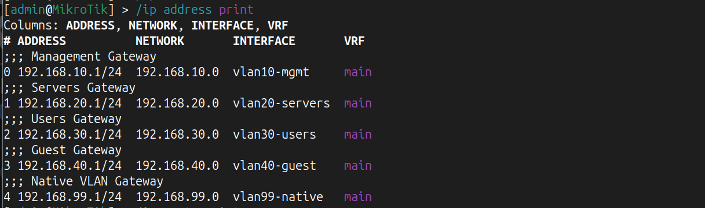
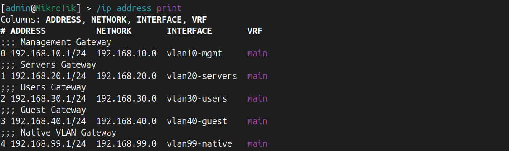
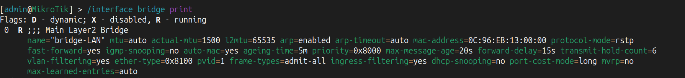
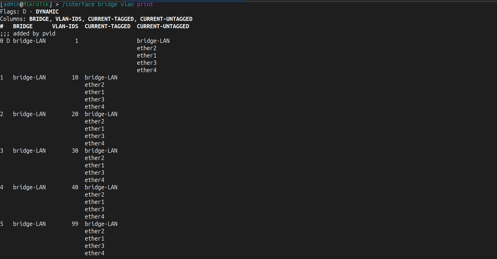
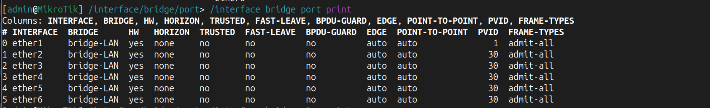
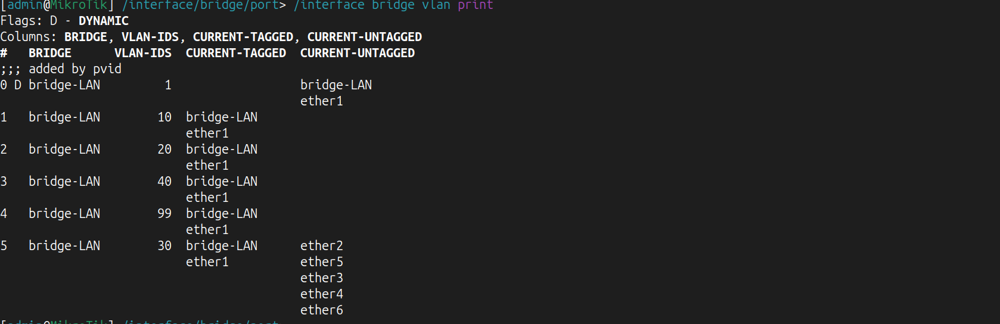
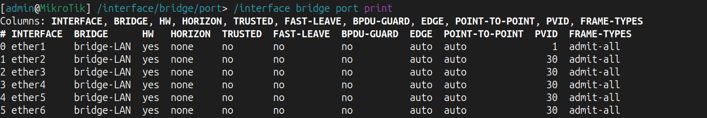
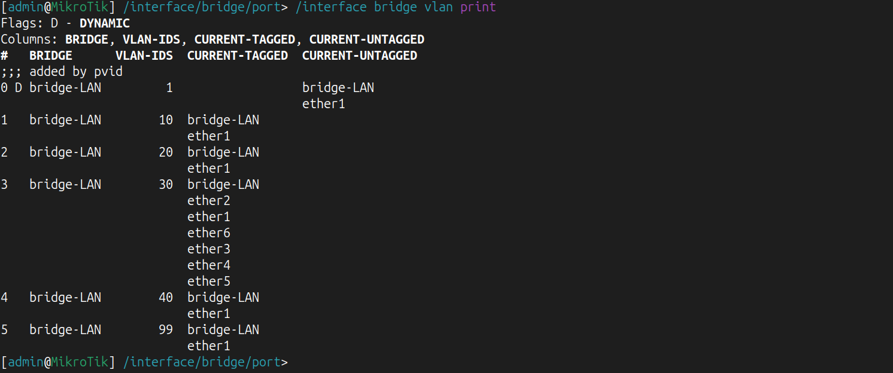

# Lab 02 - Enterprise VLAN Switching

## Overview

This lab focuses on implementing the Layer 2 infrastructure of the Enterprise HomeLab.

The objective is to build a scalable switching environment using MikroTik RouterOS by implementing VLAN segmentation, trunk links, access ports, bridge configuration, and VLAN filtering.

This lab provides the Layer 2 foundation required for future services such as DHCP, Inter-VLAN Routing, NAT, OSPF, and Infrastructure Automation.

---

# Objectives

After completing this lab the network should provide:

- Enterprise Layer 2 switching
- VLAN segmentation
- Broadcast domain isolation
- Trunk connectivity
- Access ports for end devices
- VLAN filtering
- Proper PVID assignment
- Preparation for Layer 3 routing

---

# Network Topology

> Screenshot:
> # Network Topology


---

# Theory

## What is a VLAN?

A VLAN (Virtual Local Area Network) is a logical separation of devices inside the same physical network.

Instead of creating multiple physical switches, VLANs allow multiple isolated broadcast domains to exist on a single switching infrastructure.

Benefits include:

- Better security
- Reduced broadcast traffic
- Easier management
- Improved scalability

---

## Broadcast Domains

Without VLANs every device belongs to one broadcast domain.

With VLANs every VLAN becomes its own broadcast domain.

Example:

VLAN10 → Management

VLAN20 → Servers

VLAN30 → Users

VLAN40 → Guest

---

## Bridge (RouterOS)

A Bridge in MikroTik acts as a Layer 2 switching domain.

All Ethernet interfaces participating in switching are added to the bridge.

The bridge forwards Ethernet frames based on the MAC Address Table.

---

## VLAN Filtering

VLAN Filtering enables VLAN awareness on the bridge.

Once enabled, the bridge begins forwarding frames according to the configured VLAN table.

Without VLAN filtering, VLAN configuration has no effect.

---

## Tagged vs Untagged

Tagged traffic carries an IEEE 802.1Q VLAN tag.

It is used between:

- Switch ↔ Switch
- Switch ↔ Router
- Switch ↔ Hypervisor

Untagged traffic is used by end devices such as:

- PCs
- Printers
- IP Phones (unless configured otherwise)

---

## Trunk Port

A trunk port transports multiple VLANs over a single physical link.

Example:

SW1 ←→ SW2

Allowed VLANs:

- VLAN10
- VLAN20
- VLAN30
- VLAN40
- VLAN99

---

## Access Port

An access port belongs to a single VLAN.

Connected devices are unaware of VLAN tagging.

Example:

PC01 → VLAN30

---

## PVID

PVID (Port VLAN ID) determines to which VLAN incoming untagged frames belong.

Example:

ether2

PVID = 30

Result:

Every untagged Ethernet frame received on ether2 automatically becomes part of VLAN30.

---

# Network Design

## Core Router

Device:

R2-CORE

Responsibilities:

- Gateway for every VLAN
- Future Inter-VLAN Routing
- DHCP Server
- NAT

---

## Core Switch

Device:

SW1-CORE

Responsibilities:

- VLAN Distribution
- Trunk connectivity
- Transport all VLANs

---

## Access Switches

Devices:

- SW2-ACCESS
- SW3-ACCESS

Responsibilities:

- Connect end-user devices
- Convert tagged VLAN traffic into untagged access traffic
- Assign PVID

---

# VLAN Plan

| VLAN | Name | Network | Gateway |
|------|------------|----------------|----------------|
|10|Management|192.168.10.0/24|192.168.10.1|
|20|Servers|192.168.20.0/24|192.168.20.1|
|30|Users|192.168.30.0/24|192.168.30.1|
|40|Guest|192.168.40.0/24|192.168.40.1|
|99|Native|192.168.99.0/24|192.168.99.1|

---

# Configuration Summary

## R2-CORE

Configured:

- VLAN Interfaces
- Default Gateways
- Connected Routes

Verification:

```
### R2 VLAN Interfaces


### R2 IP Addresses

```

### R2 IP Addresses


---

## SW1-CORE

Configured:

- Bridge
- Bridge Ports
- VLAN Filtering
- VLAN Table
- Trunk Ports

Verification:

```
### SW1 Bridge



### SW1 VLAN Table



---

## SW2-ACCESS

Configured:

- Bridge
- Bridge Ports
- VLAN Filtering
- Access Ports
- Trunk Port
- VLAN30 Untagged
- PVID 30

Verification:

```
### SW2 Access Ports



### SW2 VLAN Table



---

## SW3-ACCESS

Configuration identical to SW2.

---

# Verification

The following items were verified successfully.

✅ Bridge created

✅ VLAN Filtering enabled

✅ VLAN Table configured

✅ Tagged trunk links

✅ Untagged access ports

✅ PVID configured

### SW3 Access Ports



### SW3 VLAN Table



---

# Troubleshooting

## Issue 1

Access ports were initially configured as tagged.

Problem:

PCs do not generate VLAN tags.

Resolution:

Changed access ports to untagged.

---

## Issue 2

PVID remained VLAN1.

Problem:

Incoming traffic entered the wrong VLAN.

Resolution:

Configured:

PVID = 30

for all access ports.

---

## Issue 3

Duplicate IP address configured on ether2 and VLAN interface.

Problem:

Gateway existed twice.

Resolution:

Removed the IP address from the physical interface and kept it only on the VLAN interface.

---

# Lessons Learned

During this lab the following concepts became clear:

- Difference between Layer 2 and Layer 3
- Difference between Trunk and Access ports
- Difference between Tagged and Untagged traffic
- Purpose of Bridge VLAN Filtering
- Why PVID is required
- Packet flow inside a switched network

---

# Interview Questions

- What is a VLAN?
- Why do we use VLANs?
- What is a Broadcast Domain?
- Difference between Tagged and Untagged traffic?
- What is a Trunk Port?
- What is an Access Port?
- What is PVID?
- Why is VLAN Filtering required?
- Explain the packet flow from a PC to the default gateway.
- Why doesn't a PC send VLAN tags?

---

# Next Lab

## Lab 03 - DHCP Services

In the next lab we will configure:

- DHCP Pools
- DHCP Networks
- DHCP Server
- DNS
- Automatic IP Address Assignment
- Client Connectivity Testing

---

**Status:** ✅ Completed