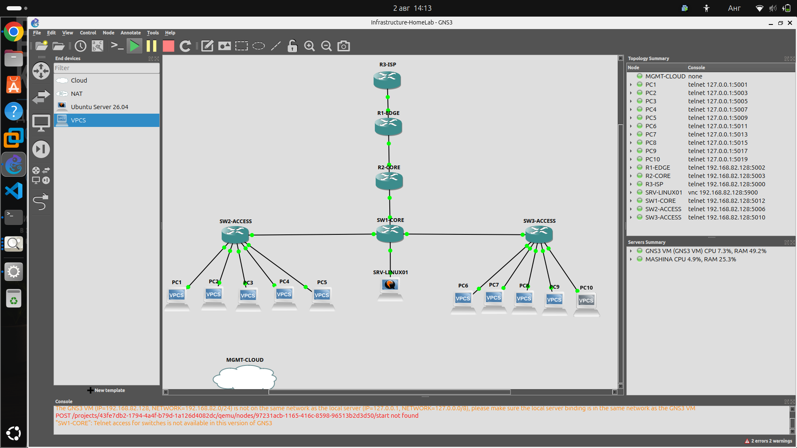

# 🏠 Infrastructure HomeLab

> Enterprise networking lab built with MikroTik RouterOS in GNS3, documented lab by lab.



---

## 📖 Overview

Infrastructure HomeLab is a personal enterprise network built from scratch in GNS3 using MikroTik RouterOS. Each lab configures one technology, verifies it, and documents the configuration, the troubleshooting and the lessons learned.

The lab is still under construction. Only the labs marked ✅ below are implemented and documented. Everything else is planned.

---

## 🏗 Topology

The lab simulates a small enterprise: an ISP router, an edge router, a core router, one core switch, two access switches, ten clients and a Linux server.

```text
GNS3 NAT → ISP router → R1-EDGE → R2-CORE → SW1-CORE → SW2-ACCESS / SW3-ACCESS → clients
```

### Addressing plan

| VLAN | Name       | Network          | Gateway        |
|------|------------|------------------|----------------|
| 10   | Management | 192.168.10.0/24  | 192.168.10.1   |
| 20   | Servers    | 192.168.20.0/24  | 192.168.20.1   |
| 30   | Users      | 192.168.30.0/24  | 192.168.30.1   |
| 40   | Guest      | 192.168.40.0/24  | 192.168.40.1   |
| 99   | Native     | 192.168.99.0/24  | 192.168.99.1   |

| Link                | Network        |
|---------------------|----------------|
| ISP ↔ R1-EDGE       | 100.64.0.0/30  |
| R1-EDGE ↔ R2-CORE   | 10.0.0.0/30    |

---

## 🛠 Technologies

### Implemented

- MikroTik RouterOS (in GNS3)
- VLANs and IEEE 802.1Q trunk / access ports
- Bridge VLAN filtering and RSTP
- DHCP server (VLAN 10, 20, 30, 40)
- Source NAT (masquerade), including double NAT through the GNS3 NAT node
- Static and default routing, route summarization
- Management network with SSH access
- GNS3 with GNS3 VM on VMware Workstation
- Git and GitHub

### Planned

- Inter-VLAN segmentation and ACLs
- Firewall
- OSPF
- Linux server administration (Ubuntu)
- Docker, Kubernetes, Ansible

---

## 📚 Roadmap

| Lab      | Topic                          | Status |
|----------|--------------------------------|:------:|
| Lab 01   | [Enterprise LAN Design](Documentation/01-Networking/Lab-01-Enterprise-LAN)                      | ✅ |
| Lab 01.5 | [Management Network](Documentation/01-Networking/Lab-01.5-Management-Network)                   | ✅ |
| Lab 02   | [Enterprise VLAN Switching](Documentation/01-Networking/Lab-02-Enterprise-VLAN-Switching)       | ✅ |
| Lab 03   | [DHCP Services](Documentation/01-Networking/Lab-03-DHCP-Services)                               | ✅ |
| Lab 04   | [NAT & Internet Access](Documentation/01-Networking/Lab-04-NAT-Internet-Access)                 | ✅ |
| Lab 05   | Inter-VLAN Routing & ACLs      | ⏳ |
| Lab 06   | Firewall                       | ⏳ |
| Lab 07   | OSPF                           | ⏳ |
| Lab 08   | Linux Server                   | ⏳ |
| Lab 09   | Docker                         | ⏳ |
| Lab 10   | Kubernetes                     | ⏳ |
| Lab 11   | Python Automation              | ⏳ |
| Lab 12   | Ansible                        | ⏳ |

---

## 📂 Repository Structure

```text
Infrastructure-HomeLab/
├── Assets/
│   ├── Banners/
│   └── Diagrams/
├── Documentation/
│   └── 01-Networking/
│       ├── Lab-01-Enterprise-LAN/
│       ├── Lab-01.5-Management-Network/
│       ├── Lab-02-Enterprise-VLAN-Switching/
│       ├── Lab-03-DHCP-Services/
│       └── Lab-04-NAT-Internet-Access/
└── README.md
```

Each lab folder contains a README, the exported device configurations (`configs/`) and screenshots (`screenshots/`). Folders for later topics are added when there is something to put in them.

---

## 📍 Current Status

- ✅ Labs 01 to 04 are implemented, verified and documented.
- 🚧 Next: inter-VLAN segmentation and ACLs, then firewall and OSPF.
- 🔗 A companion project, Python Chaos Lab, is in early development and will later test this infrastructure.

---

## 👨‍💻 Author

**Georgi Zhgumov**